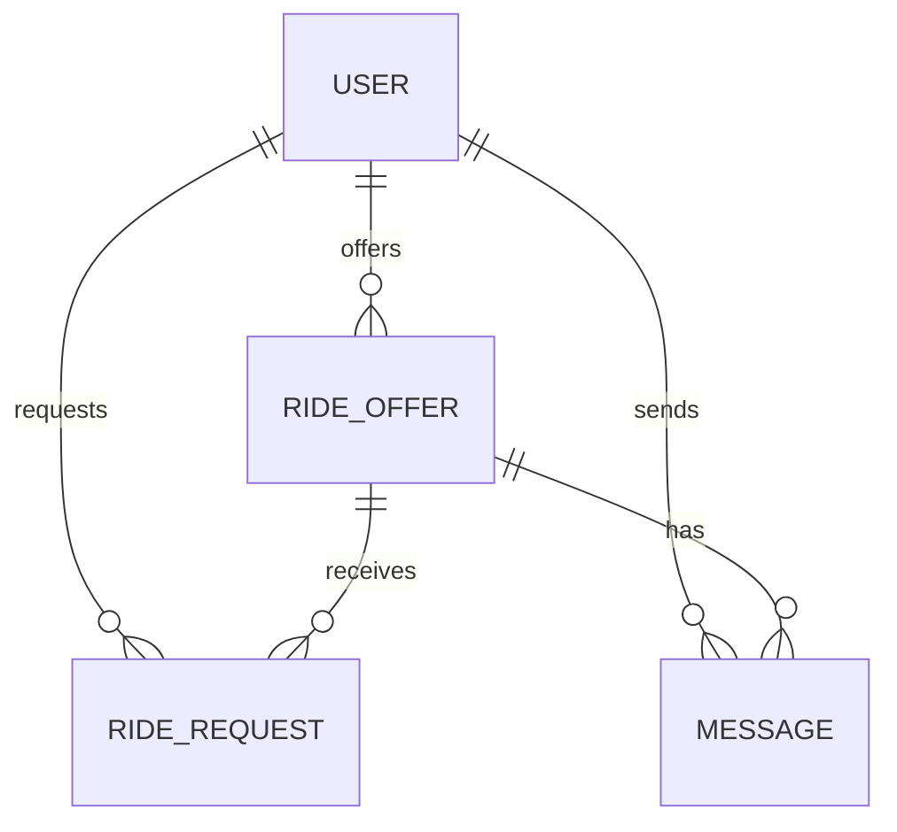

# 🛠️ Architecture / SSD

**Projeto:** Caronas UTFPR
**Versão:** 1.0.0
**Última atualização:** 13/10/2026

> 🤖 **O `prd.md` responde _o quê_ o produto faz. Este responde _onde as coisas
> moram e como se chamam_.** Detalhe de tela — rota, componente, contrato —
> **não** se decide aqui: isso é trabalho da spec de cada história.
> (No texto oficial da disciplina este documento é o `ssd.md` — ID31.)
>
> ✍️ Este documento foi preenchido com as decisões da entrevista de arquitetura.
> Ele garante as quatro exigências do `/utf-setup`: stack do frontend, BaaS,
> estrutura do projeto e como rodar os testes.

---

## 🤖 1. Fontes de Contexto para a IA

| Fonte | Onde configurar | Serve para |
| :---- | :-------------- | :--------- |
| Constituição da IA | `.agents/rules/utf-rules.md` (via `CLAUDE.md`) | Regras inegociáveis: fases do SDD, 2 rodadas, revisores distintos, Gitflow |
| Fluxos da IA | `.agents/workflows/` | PRD, backlog, design, architecture, setup, ciclo por Issue, ciclo por tarefa, tutor |
| Agentes (subagentes) | `.agents/agents/` (cascas em `.claude/`, `.cursor/`, `.opencode/`) | Implementador, revisores, auditor final e tutor |
| Ficha da disciplina | `docs/checklist.md` | Regras do projeto, IDs e entregas |
| Protótipo (Stitch/Figma) | https://www.figma.com/design/lKeGyx9s4LH1bQ7KTdt6dN/Untitled?node-id=1-1128&t=nXCuX4tWgNwH5yPn-0 | Telas, jornadas e hierarquia visual (ID1) |
| MCPs da IDE | Figma, Supabase, Context7 | Contexto exato do projeto para o agente (ID32) |

---

## 📦 2. Stack Tecnológica

- **Frontend:** Angular 20+ — arquitetura standalone, signals, sintaxe moderna.
- **Padrões de código exigidos** (IDs 4, 6, 7, 9, 10–15):
  `@if`/`@switch`, `@for` com `track`, `@defer`, signals (writable/computed)
  como fonte de estado, `model()` para two-way, `effect()` para efeitos colaterais,
  `input()`/`output()`, `inject()`, pipes para formatação.
- **Framework CSS:** Tailwind CSS (ID5)
- **Dados (em duas fases):** json-server no MVP (E2) → Supabase na E3, com autenticação JWT e CRUD reais (IDs 21–22). A troca atinge só os Services (§2.1).
- **PWA:** `manifest.webmanifest` com tema, splash, standalone, ícones e comportamento offline (ID3)
- **Testes e lint:** Angular + Vitest + ESLint; comandos: `npm run test` e `npm run lint` (ID33).

### 🌐 2.1. Camada de dados — regras estruturais

- **Componente não fala com o servidor:** todo acesso a dados passa por Services
  injetados via `inject()` (ID15). Mudança de contrato mexe só nos Services,
  nunca nas telas.
- **Autenticação e sessão (JWT):** Supabase Auth gerencia sessão e token JWT,
  com guard funcional e interceptor global (ID21, ID23).
- **Interceptors funcionais:** token injetado globalmente e tratamento
  centralizado de erro (ID23).
- **Assíncrono ↔ reativo:** `toSignal()`/`toObservable()` na fronteira entre
  RxJS e signals (ID25).
- **Formulários Reativos:** validação por campo, mensagens de erro claras e botão
  de submit desabilitado enquanto inválido (ID24).

---

## 🗂️ 3. Estrutura do Projeto

```text
.
├── .agents/               # constituição, workflows e prompts dos agentes
├── CLAUDE.md / AGENTS.md  # cascas por ferramenta (.claude/, .cursor/, .opencode/)
├── README.md              # a vitrine com links para PRD, architecture e checklist
├── docs/                  # prd.md, design-tokens.md, architecture.md, checklist.md
├── specs/                 # uma pasta por história implementada
├── package.json           # scripts de orquestração da raiz
└── apps/
    ├── web/               # app Angular principal
    └── api/               # reservada para uma API real futura, mantida vazia no MVP
```

### 📦 3.1. A raiz do monorepo (npm workspaces)

```json
{
  "name": "caronas-utfpr",
  "private": true,
  "workspaces": ["apps/*"],
  "scripts": {
    "start": "npm run start -w apps/web",
    "build": "npm run build -w apps/web",
    "test": "npm run test -w apps/web",
    "lint": "npm run lint -w apps/web",
    "format": "prettier --write .",
    "api": "json-server db.json"
  }
}
```

### Organização interna do app (`apps/web/src/app/`)

```text
apps/web/src/app/
├── core/
│   ├── auth/
│   ├── services/
│   ├── guards/
│   ├── interceptors/
│   └── utils/
├── shared/
│   ├── components/
│   ├── pipes/
│   └── ui/
├── features/
│   ├── auth/
│   ├── rides/
│   ├── requests/
│   ├── chat/
│   └── profile/
└── app.routes.ts
```

Regra de dependência: `features` não importam entre si; acessam dados via Services
em `core`, e componentes reutilizáveis ficam em `shared`.

---

## 🧭 4. Roteamento e Navegação

A estrutura de rotas usa `provideRouter`, `withComponentInputBinding()`, Signal `input()`
para leitura de parâmetros, rotas filhas para layout aninhado e guards/resolvers.

### Rotas principais

- `/` — landing / busca de caronas
- `/login` — autenticação
- `/ofertas` — listagem de caronas disponíveis
- `/ofertas/:id` — detalhe da carona
- `/ofertas/nova` — publicar oferta
- `/minhas-caronas` — gestão das ofertas do usuário
- `/solicitacoes` — solicitações recebidas e enviadas
- `/chat/:rideId` — chat da carona
- `/perfil` — dados do usuário

### Regras

- `withComponentInputBinding()` habilita passagem automática de parâmetros da rota
  para o componente de destino.
- `input()` no componente lê os parâmetros da URL de forma reativa.
- rotas filhas agrupam páginas do mesmo domínio para o layout aninhado.
- guard funcional bloqueia acesso de usuários não autenticados.
- resolver carrega dados antes da navegação quando necessário.

---

## 🗄️ 5. Arquitetura de Dados (BaaS)

### 📖 5.1. Glossário Técnico (Mapeamento)

| Termo PRD (PT-BR) | Entidade/Tabela (EN) | Atributos principais |
| :---------------- | :------------------- | :------------------- |
| Usuário | `User` | `id`, `name`, `email`, `role`, `isVisitor`, `badge`, `createdAt` |
| Oferta de carona | `RideOffer` | `id`, `driverId`, `origin`, `destination`, `departureDate`, `departureTime`, `seatsAvailable`, `status`, `createdAt` |
| Solicitação de vaga | `RideRequest` | `id`, `rideOfferId`, `passengerId`, `status`, `requestedAt`, `approvedAt` |
| Mensagem do chat | `Message` | `id`, `rideOfferId`, `senderId`, `content`, `sentAt` |
| Notificação | `Notification` | `id`, `userId`, `type`, `message`, `read`, `createdAt` |
| Rota | `Route` | `id`, `origin`, `destination`, `distanceKm`, `estimatedDuration` |

### 📊 5.2. Diagrama ER (Mermaid)



### 🔒 5.3. Segredos e ambientes

- `.env.example` fica versionado com variáveis esperadas.
- `.env.local` ou variáveis do ambiente de runtime ficam fora do repositório.
- segredos do Supabase e JWT não entram em commits.
- os ambientes de desenvolvimento e produção são separados.
- a anon key fica no ambiente do cliente; segredos e chaves sensíveis ficam no servidor/BaaS ou no runtime seguro.

| Fase | App roda em | Dados |
| :--- | :--- | :--- |
| **Local (E2/MVP)** | `ng serve` | json-server (`db.json` local) |
| **Local (E3)** | `ng serve` | Supabase (projeto de desenvolvimento) |
| **Produção (E3)** | Vercel/Render | Supabase (projeto de produção) |

---

## 🧭 6. Fluxo de autenticação (JWT)

- Supabase Auth é a fonte de identidade.
- a sessão do usuário expõe o token JWT do BaaS.
- `HttpInterceptor` injeta o token em todas as requisições autenticadas.
- `AuthGuard` bloqueia rotas protegidas quando a sessão não existe.
- `logout()` limpa a sessão local e redireciona para `/login`.
- em `401`, o app faz redirecionamento ou limpa sessão e avisa o usuário.

## 🔐 7. Interceptadores e tratamento de erro

- `AuthInterceptor` injeta `Authorization` no header das requisições.
- `ErrorInterceptor` centraliza erros de rede e resposta.
- `401` dispara logout/redirect para login.
- `400`/`422` exibem mensagens de validação amigáveis no UI.
- feedback visual (toast) para falhas e sucesso de operações.

## 🧪 8. Validação de formulários

- formulários reativos com `FormBuilder`/`FormGroup`/`FormControl`
- `Validators.required`, `minLength`, `pattern`, custom validators por domínio.
- submit desabilitado enquanto o formulário estiver inválido.
- mensagens de erro por campo, com feedback visual em UI.

## 🗂️ 9. Camada de Serviços e Contratos

A regra da disciplina é clara: cada componente comunica com a API por meio de
Services/Repositórios. O backend pode trocar de json-server para Supabase sem
alterar as telas.

### Padrões

- `core/services` para operações de dados
- `core/repositories` para abstração do backend
- contratos em interfaces/tipos compartilhados
- `RideOffer`, `RideRequest`, `Message`, `User`, `Notification` como tipos do domínio
- camada adaptadora por backend: `json-server` e `supabase` implementam os mesmos contratos

### Exemplo de contrato

```ts
export type RideOfferStatus = 'Ativa' | 'Encerrada' | 'Cancelada';

export interface RideOffer {
  id: string;
  driverId: string;
  origin: string;
  destination: string;
  departureDate: string;
  departureTime: string;
  seatsAvailable: number;
  status: RideOfferStatus;
  createdAt: string;
}
```

---

## 🗺️ 10. Mapa de Domínios e Rotas

| Domínio | Rota | Guard | Dados (service) | US |
| :------ | :--- | :---- | :-------------- | :-- |
| Autenticação | `/login` | `authGuard` | `authService` | login e sessão |
| Caronas | `/ofertas` | `authGuard` | `rideOfferService` | busca e listagem |
| Oferta | `/ofertas/nova` | `authGuard` | `rideOfferService` | publicar oferta |
| Detalhe | `/ofertas/:id` | `authGuard` | `rideOfferService` | visualizar carona |
| Solicitações | `/solicitacoes` | `authGuard` | `rideRequestService` | aceitar/recusar vagas |
| Chat | `/chat/:rideId` | `authGuard` | `messageService` | mensagens da viagem |
| Perfil | `/perfil` | `authGuard` | `userService` | dados do usuário |

---

## 📅 11. Histórico

| Data | Versão | O que mudou |
| :--- | :----- | :---------- |
| 2026-10-13 | 1.0.0 | Primeira versão do architecture.md preenchida com decisões de stack, dados, auth, routing e arquitetura de software. |

---

## 🛑 O que ainda **não** está neste documento

Detalhes de funcionalidade de uma tela específica, fluxos de uma história ou
contratos finos de componente não entram aqui. Eles nascem em `spec.md` por história,
como manda a disciplina. Este documento guarda o que vale para todo o sistema.
