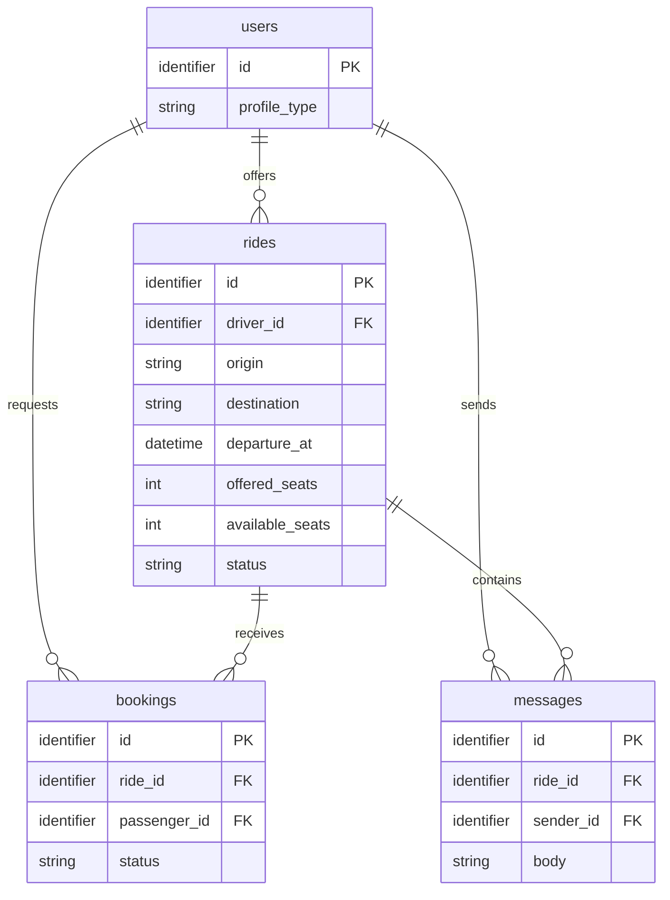

# Arquitetura — Caronas UTFPR

**Status:** modelo lógico documentado; decisões de implementação pendentes
**Última atualização:** 2026-10-19

Este documento registra as decisões sustentadas pelos requisitos e identifica
separadamente o que a equipe ainda precisa decidir. O PRD continua sendo a fonte
das regras de negócio; esta arquitetura não altera seus critérios.

## 1. Fontes do projeto

| Fonte | Responsabilidade |
| --- | --- |
| [PRD](prd.md) | Requisitos, atores, histórias e regras de negócio. |
| [Tokens de design](design-tokens.md) | Referência visual; valores ainda aguardam confirmação no protótipo. |
| [Checklist](checklist.md) | Requisitos da disciplina e entregas. |
| [README](../README.md) | Resumo do projeto e links registrados para protótipos. |
| Protótipo Figma | [Link registrado no README](https://www.figma.com/design/lKeGyx9s4LH1bQ7KTdt6dN/Untitled?node-id=1-1128&t=nXCuX4tWgNwH5yPn-0); conteúdo não verificado nesta edição. |
| Protótipo Stitch | [Link registrado no README](https://stitch.google.com/projects/8491646570534218067?pli=1); conteúdo não verificado nesta edição. |

## 2. Plataforma e decisões técnicas

### Confirmado nos documentos

- **Frontend:** Angular 20+, com componentes standalone e Signals, conforme a
  stack fixa da disciplina e os IDs 4 e 10–13 do checklist.
- **Dados na Entrega 2:** json-server. Não há backend próprio previsto para o MVP.
- **Dados na Entrega 3:** um BaaS com autenticação JWT e operações CRUD; o
  provedor ainda não está ratificado na arquitetura.
- **Fronteira de dados:** componentes não acessam diretamente o servidor; o
  acesso fica em Services. A troca de provedor deve ficar isolada nessa camada,
  conforme o checklist.
- **Testes:** o checklist requer testes unitários `.spec.ts` para regras de
  negócio (ID33).
- **PWA:** o checklist exige experiência PWA e configuração de manifest,
  ícones, cores, splash, modo standalone e previsão de estado offline (ID3).

### Pendências de decisão

| Tema | Situação e decisão necessária |
| --- | --- |
| Framework CSS | Pendente de confirmação pela equipe. O README também registra a escolha como pendente; não assumir Tailwind ou outra opção antes da decisão. |
| BaaS da Entrega 3 | Pendente de confirmação pela equipe. O README também registra o provedor como pendente; defini-lo antes de fechar schema físico, autenticação e políticas de acesso. |
| Runner, lint e comandos | Pendente. Não há aplicação nem `package.json` no workspace para confirmar ferramentas ou comandos. |
| Localização do `db.json` | Pendente. A existência do json-server na E2 está definida, mas nenhum arquivo de dados ou caminho foi criado/documentado. |
| Autenticação concreta | Pendente. JWT e serviço de identidade do BaaS são requisitos da E3; provedor, fluxo e associação do usuário de autenticação ao perfil ainda não foram definidos. |
| PWA e estado offline | Pendente. A exigência está no checklist; manifest, recursos, telas e comportamento offline não estão implementados nem especificados pelo PRD. |

### Padrões exigidos pela disciplina

A implementação deve seguir Angular standalone, Signals e a sintaxe moderna
enumerada no checklist (IDs 4, 6–15). O checklist também requer `provideRouter`,
`withComponentInputBinding()`, Functional Guards, Resolvers e Functional
Interceptors (IDs 16–19 e 23), além de Formulários Reativos e a ponte entre RxJS
e Signals (IDs 24–25). Esses itens são requisitos de implementação, não
evidência de que já estejam implementados.

## 3. Estrutura e organização

### Estado verificável do workspace

- `apps/web/` existe, mas contém somente `.gitkeep`; ainda não há aplicação
  Angular, rotas, componentes, Services ou configuração de testes.
- `apps/api/README.md` registra que a pasta está reservada para uma API própria
  futura e que o setup não a gera. O projeto não prevê backend próprio para as
  entregas atuais.
- Não há `package.json` na raiz nem nos diretórios de aplicação; portanto,
  workspaces npm, scripts e comandos de execução não podem ser tratados como
  decisões existentes.

### Organização interna

O esqueleto anterior mencionava `core/`, `shared/` e `features/`, mas isso estava
como anotação não ratificada e não existe no workspace. A divisão, os nomes das
pastas e as regras de dependência entre componentes compartilhados e features
permanecem pendentes de confirmação. Até essa decisão, não se deve assumir que
um componente ou Service já tem localização definida.

## 4. Rotas e navegação

O PRD define as histórias abaixo, mas não define URLs nem a composição das telas
em rotas. Como ainda não há aplicação no workspace, nenhuma rota está
implementada ou confirmada.

| História | Fluxo de negócio | Rota |
| --- | --- | --- |
| US01 | Publicar oferta de carona | Pendente: definir na especificação da história. |
| US02 | Pesquisar caronas | Pendente: definir na especificação da história. |
| US03 | Solicitar vaga | Pendente: definir na especificação da história. |
| US04 | Avaliar solicitações da oferta | Pendente: definir na especificação da história. |
| US05 (`Should Have`) | Conversar no chat da carona | Pendente: definir na especificação da história. |

O checklist exige Guards e Resolvers (ID19), mas o vínculo entre rotas, sessão e
permissões de cada ator depende da definição das rotas e do provedor de
autenticação.

## 5. Glossário técnico

Os nomes abaixo são nomes lógicos em inglês para o modelo do domínio. Não
definem, por si sós, nomes físicos de tabelas, formato de API ou tecnologia de
persistência.

| Termo do PRD | Nome técnico | Representação lógica |
| --- | --- | --- |
| Aluno, Professor, Visitante | `users` | `id`, `profile_type` (`student`, `professor`, `visitor`). O vínculo com a identidade/autenticação física está pendente. |
| Motorista | `users` como driver | `rides.driver_id` referencia o usuário que publicou a carona; motorista é papel no contexto da carona, não entidade separada. |
| Passageiro | `users` como passenger | `bookings.passenger_id` referencia quem solicita a vaga; passageiro é papel no contexto da solicitação, não entidade separada. |
| Carona (Viagem) | `rides` | `id`, `driver_id`, `origin`, `destination`, `departure_at`, `offered_seats`, `available_seats`, `status`, `meeting_point` (definido pelo motorista; tipo e representação física pendentes). |
| Solicitação | `bookings` | `id`, `ride_id`, `passenger_id`, `status`. Sua criação gera notificação interna ao motorista; e-mail e push não fazem parte desta decisão, e a implementação técnica está pendente. |
| Status da Solicitação | `bookings.status` | `pending`, `accepted` ou `rejected`, correspondentes a Pendente, Aceita e Recusada no PRD. |
| Vaga | `rides.offered_seats` e `rides.available_seats` | Quantidade ofertada e saldo disponível; não é entidade separada nem reserva automática. |
| Reserva confirmada | Sem entidade separada | Efeito da aceitação de uma `booking`: reserva uma vaga e reduz o saldo disponível. |
| Ponto de Encontro | `rides.meeting_point` | Atributo da carona definido pelo motorista. Tipo, formato, validação e representação física não foram definidos. Os participantes podem alinhar detalhes no chat (US05). |
| Mensagem do chat | `messages` | `id`, `ride_id`, `sender_id`, `body`. Entidade lógica para a US05 (`Should Have`); armazenamento e serviço em tempo real dependem do BaaS escolhido. |

## 6. Modelo lógico de dados

O diagrama representa entidades lógicas derivadas do PRD. O schema físico,
tipos específicos do provedor, índices e políticas de acesso ficam pendentes da
decisão de BaaS. `messages` atende à US05, classificada como `Should Have`. O PRD
define `meeting_point` como atributo lógico de `rides`, mas seu tipo físico não
foi decidido; por isso, ele não aparece como atributo tipado neste diagrama.

### Regras que o modelo precisa preservar

- `rides.departure_at` deve estar no futuro e `offered_seats` deve ser pelo
  menos 1 (RN01). A busca considera somente caronas `active`, futuras e com
  `available_seats` maior que zero (RN02). Outros estados de carona não estão
  definidos no PRD.
- A aprovação é manual pelo motorista. Ao aceitar uma `booking`, o status passa
  a `accepted` e `available_seats` diminui em 1; se não houver saldo, a aceitação
  é bloqueada (RN03 e US04). O mecanismo transacional/concorrente ainda depende
  do provedor e não está especificado.
- Uma solicitação `rejected` permite nova tentativa para a mesma carona.
  Solicitações `pending` ou `accepted` impedem outra solicitação ativa do mesmo
  passageiro para a mesma carona (US03 e RN04). Não impor unicidade global sobre
  `passenger_id` e `ride_id`, pois isso impediria o histórico de recusas.
- A solicitação criada gera uma notificação interna ao motorista. E-mail e push
  não fazem parte desta decisão; provedor, mecanismo e persistência da
  notificação não foram definidos.
- Somente o motorista proprietário da carona (`rides.driver_id`) pode aceitar
  ou recusar as solicitações recebidas para aquela carona.
- Recusar uma `booking` não altera `available_seats`; aceitar reduz o saldo em
  uma unidade. A regra bloqueia aceitação quando não há saldo (US04, RN03).
  O PRD não define a garantia técnica para aceitações concorrentes; isso depende
  de decisão técnica futura, sem solução presumida nesta arquitetura.
- O chat é restrito ao motorista e a passageiros com `booking` `accepted` (RN05).
  Mensagens vazias ou compostas apenas por espaços não são registradas (US05).
  A implementação também deve atender à atualização em tempo real prevista na
  RNF02.
- A badge de Visitante é uma obrigação de apresentação em perfil, oferta e
  solicitação (RN06); `profile_type` fornece o tipo lógico para identificar esse
  perfil. Os valores visuais estão em [design-tokens.md](design-tokens.md).

## 7. Persistência, acesso e testes

- **Entrega 2:** json-server, sem backend próprio. Caminho e estrutura do arquivo
  de dados ainda não estão definidos.
- **Entrega 3:** BaaS com JWT e CRUD. O provedor e o schema físico permanecem
  pendentes, como também registra o README.
- **Acesso a dados:** somente Services devem acessar a fonte de dados; a troca
  entre provedores deve ficar isolada nessa camada.
- **Autorização:** o PRD restringe alterações ao motorista da carona, decisões
  de aceite/recusa, e chat a participantes aceitos. Estratégia concreta de
  Guards e políticas no BaaS depende das rotas e do provedor ainda não definidos.
- **Testes:** cobrir as regras de negócio com testes unitários `.spec.ts` conforme
  ID33. Runner e comandos só podem ser registrados após o setup da aplicação.

## 8. Decisões pendentes

1. Confirmar o framework CSS, atualmente pendente no README e nesta arquitetura.
2. Confirmar o BaaS da Entrega 3, também pendente no README, e como sua
  identidade se relaciona a `users`.
3. Definir a localização e o schema inicial do `db.json` para a Entrega 2.
4. Definir a organização interna de componentes/Services e suas regras de
   dependência.
5. Definir as rotas e seus Guards/Resolvers nas specs das histórias.
6. Confirmar no PRD se as permissões de Professor devem incluir a mesma
  proibição explícita que consta para Aluno sobre aceitar solicitações em
  caronas de outros motoristas; não inferir uma resposta pela arquitetura.
7. Definir quando uma pessoa pode cancelar uma solicitação própria e quais
  efeitos esse cancelamento tem sobre status e vagas.
8. Confirmar se o ponto de encontro é obrigatório na oferta e quais regras de
  negócio se aplicam a esse atributo.
9. Definir como a notificação interna exigida pela US03 será apresentada ao
  motorista, sem presumir canal, tela ou mecanismo.
10. Definir schema físico, índices e mecanismo de consistência para a aceitação
   de solicitações após a escolha do BaaS.
11. Registrar runner, lint e comandos de teste após a criação da aplicação.
12. Definir tipo, formato, validações e representação física de `meeting_point`;
   o PRD confirma que é atributo de `rides`, mas não detalha esses aspectos.
13. Definir a implementação técnica da notificação interna, sem presumir
  provedor, persistência, endpoint ou canal além do requisito aprovado.
14. Definir a garantia técnica contra aceitações concorrentes que poderiam
  ultrapassar `available_seats`; o PRD estabelece o limite de vagas, mas não
  especifica o mecanismo concorrente.

## 9. Histórico

| Data | Alteração |
| --- | --- |
| 2026-10-19 | Remoção do template; registro do modelo lógico derivado do PRD e das decisões técnicas ainda pendentes. |
