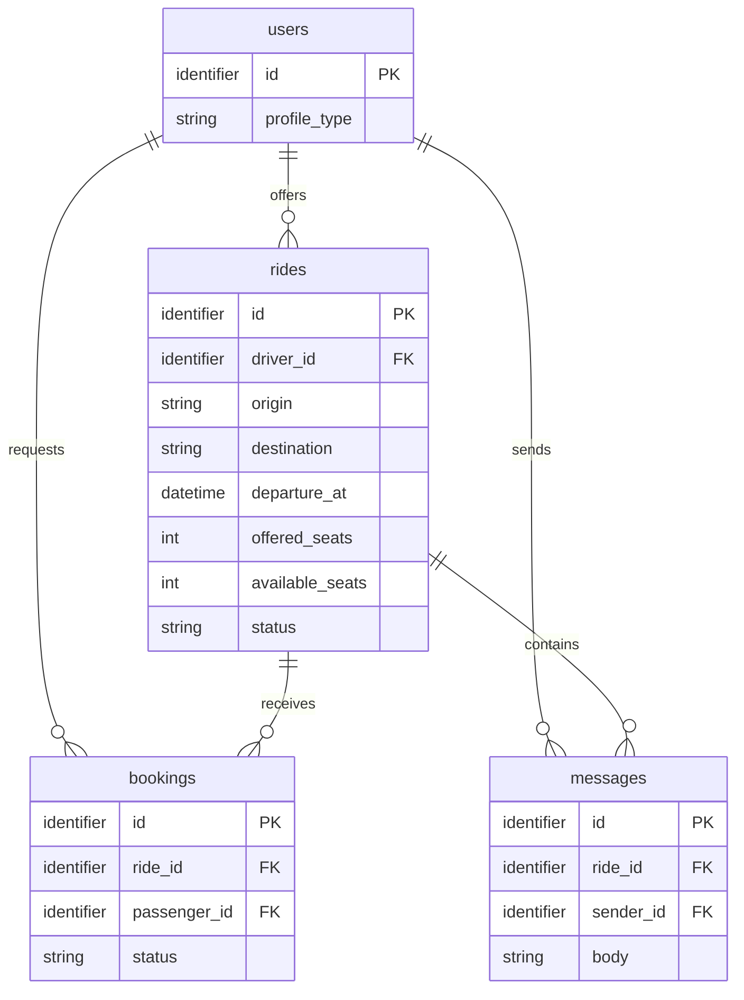
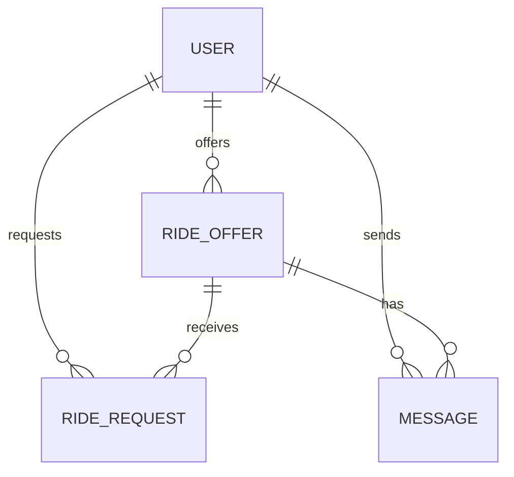

# Arquitetura — Caronas UTFPR

**Status:** modelo lógico documentado; decisões de implementação pendentes
**Última atualização:** 2026-10-19

Este documento registra as decisões sustentadas pelos requisitos e identifica
separadamente o que a equipe ainda precisa decidir. O PRD continua sendo a fonte
das regras de negócio; esta arquitetura não altera seus critérios.

## 1. Fontes do projeto

| Fonte | Responsabilidade |
| --- | --- |
| [PRD](prd.md) | Requisitos, atores, histórias e regras de negócio. |
| [Tokens de design](design-tokens.md) | Referência visual; valores ainda aguardam confirmação no protótipo. |
| [Checklist](checklist.md) | Requisitos da disciplina e entregas. |
| [README](../README.md) | Resumo do projeto e links registrados para protótipos. |
| Protótipo Figma | [Link registrado no README](https://www.figma.com/design/lKeGyx9s4LH1bQ7KTdt6dN/Untitled?node-id=1-1128&t=nXCuX4tWgNwH5yPn-0); conteúdo não verificado nesta edição. |
| Protótipo Stitch | [Link registrado no README](https://stitch.google.com/projects/8491646570534218067?pli=1); conteúdo não verificado nesta edição. |

## 2. Plataforma e decisões técnicas

### Confirmado nos documentos

- **Frontend:** Angular 20+, com componentes standalone e Signals, conforme a
  stack fixa da disciplina e os IDs 4 e 10–13 do checklist.
- **Dados na Entrega 2:** json-server. Não há backend próprio previsto para o MVP.
- **Dados na Entrega 3:** um BaaS com autenticação JWT e operações CRUD; o
  provedor ainda não está ratificado na arquitetura.
- **Fronteira de dados:** componentes não acessam diretamente o servidor; o
  acesso fica em Services. A troca de provedor deve ficar isolada nessa camada,
  conforme o checklist.
- **Testes:** o checklist requer testes unitários `.spec.ts` para regras de
  negócio (ID33).
- **PWA:** o checklist exige experiência PWA e configuração de manifest,
  ícones, cores, splash, modo standalone e previsão de estado offline (ID3).

### Pendências de decisão

| Tema | Situação e decisão necessária |
| --- | --- |
| Framework CSS | Pendente de confirmação pela equipe. O README também registra a escolha como pendente; não assumir Tailwind ou outra opção antes da decisão. |
| BaaS da Entrega 3 | Pendente de confirmação pela equipe. O README também registra o provedor como pendente; defini-lo antes de fechar schema físico, autenticação e políticas de acesso. |
| Runner, lint e comandos | Pendente. Não há aplicação nem `package.json` no workspace para confirmar ferramentas ou comandos. |
| Localização do `db.json` | Pendente. A existência do json-server na E2 está definida, mas nenhum arquivo de dados ou caminho foi criado/documentado. |
| Autenticação concreta | Pendente. JWT e serviço de identidade do BaaS são requisitos da E3; provedor, fluxo e associação do usuário de autenticação ao perfil ainda não foram definidos. |
| PWA e estado offline | Pendente. A exigência está no checklist; manifest, recursos, telas e comportamento offline não estão implementados nem especificados pelo PRD. |

### Padrões exigidos pela disciplina

A implementação deve seguir Angular standalone, Signals e a sintaxe moderna
enumerada no checklist (IDs 4, 6–15). O checklist também requer `provideRouter`,
`withComponentInputBinding()`, Functional Guards, Resolvers e Functional
Interceptors (IDs 16–19 e 23), além de Formulários Reativos e a ponte entre RxJS
e Signals (IDs 24–25). Esses itens são requisitos de implementação, não
evidência de que já estejam implementados.

## 3. Estrutura e organização

### Estado verificável do workspace

- `apps/web/` existe, mas contém somente `.gitkeep`; ainda não há aplicação
  Angular, rotas, componentes, Services ou configuração de testes.
- `apps/api/README.md` registra que a pasta está reservada para uma API própria
  futura e que o setup não a gera. O projeto não prevê backend próprio para as
  entregas atuais.
- Não há `package.json` na raiz nem nos diretórios de aplicação; portanto,
  workspaces npm, scripts e comandos de execução não podem ser tratados como
  decisões existentes.

### Organização interna

O esqueleto anterior mencionava `core/`, `shared/` e `features/`, mas isso estava
como anotação não ratificada e não existe no workspace. A divisão, os nomes das
pastas e as regras de dependência entre componentes compartilhados e features
permanecem pendentes de confirmação. Até essa decisão, não se deve assumir que
um componente ou Service já tem localização definida.

## 4. Rotas e navegação

O PRD define as histórias abaixo, mas não define URLs nem a composição das telas
em rotas. Como ainda não há aplicação no workspace, nenhuma rota está
implementada ou confirmada.

| História | Fluxo de negócio | Rota |
| --- | --- | --- |
| US01 | Publicar oferta de carona | Pendente: definir na especificação da história. |
| US02 | Pesquisar caronas | Pendente: definir na especificação da história. |
| US03 | Solicitar vaga | Pendente: definir na especificação da história. |
| US04 | Avaliar solicitações da oferta | Pendente: definir na especificação da história. |
| US05 (`Should Have`) | Conversar no chat da carona | Pendente: definir na especificação da história. |

O checklist exige Guards e Resolvers (ID19), mas o vínculo entre rotas, sessão e
permissões de cada ator depende da definição das rotas e do provedor de
autenticação.

## 5. Glossário técnico

Os nomes abaixo são nomes lógicos em inglês para o modelo do domínio. Não
definem, por si sós, nomes físicos de tabelas, formato de API ou tecnologia de
persistência.

| Termo do PRD | Nome técnico | Representação lógica |
| --- | --- | --- |
| Aluno, Professor, Visitante | `users` | `id`, `profile_type` (`student`, `professor`, `visitor`). O vínculo com a identidade/autenticação física está pendente. |
| Motorista | `users` como driver | `rides.driver_id` referencia o usuário que publicou a carona; motorista é papel no contexto da carona, não entidade separada. |
| Passageiro | `users` como passenger | `bookings.passenger_id` referencia quem solicita a vaga; passageiro é papel no contexto da solicitação, não entidade separada. |
| Carona (Viagem) | `rides` | `id`, `driver_id`, `origin`, `destination`, `departure_at`, `offered_seats`, `available_seats`, `status`, `meeting_point` (definido pelo motorista; tipo e representação física pendentes). |
| Solicitação | `bookings` | `id`, `ride_id`, `passenger_id`, `status`. Sua criação gera notificação interna ao motorista; e-mail e push não fazem parte desta decisão, e a implementação técnica está pendente. |
| Status da Solicitação | `bookings.status` | `pending`, `accepted` ou `rejected`, correspondentes a Pendente, Aceita e Recusada no PRD. |
| Vaga | `rides.offered_seats` e `rides.available_seats` | Quantidade ofertada e saldo disponível; não é entidade separada nem reserva automática. |
| Reserva confirmada | Sem entidade separada | Efeito da aceitação de uma `booking`: reserva uma vaga e reduz o saldo disponível. |
| Ponto de Encontro | `rides.meeting_point` | Atributo da carona definido pelo motorista. Tipo, formato, validação e representação física não foram definidos. Os participantes podem alinhar detalhes no chat (US05). |
| Mensagem do chat | `messages` | `id`, `ride_id`, `sender_id`, `body`. Entidade lógica para a US05 (`Should Have`); armazenamento e serviço em tempo real dependem do BaaS escolhido. |

## 6. Modelo lógico de dados

O diagrama representa entidades lógicas derivadas do PRD. O schema físico,
tipos específicos do provedor, índices e políticas de acesso ficam pendentes da
decisão de BaaS. `messages` atende à US05, classificada como `Should Have`. O PRD
define `meeting_point` como atributo lógico de `rides`, mas seu tipo físico não
foi decidido; por isso, ele não aparece como atributo tipado neste diagrama.



### Regras que o modelo precisa preservar

- `rides.departure_at` deve estar no futuro e `offered_seats` deve ser pelo
  menos 1 (RN01). A busca considera somente caronas `active`, futuras e com
  `available_seats` maior que zero (RN02). Outros estados de carona não estão
  definidos no PRD.
- A aprovação é manual pelo motorista. Ao aceitar uma `booking`, o status passa
  a `accepted` e `available_seats` diminui em 1; se não houver saldo, a aceitação
  é bloqueada (RN03 e US04). O mecanismo transacional/concorrente ainda depende
  do provedor e não está especificado.
- Uma solicitação `rejected` permite nova tentativa para a mesma carona.
  Solicitações `pending` ou `accepted` impedem outra solicitação ativa do mesmo
  passageiro para a mesma carona (US03 e RN04). Não impor unicidade global sobre
  `passenger_id` e `ride_id`, pois isso impediria o histórico de recusas.
- A solicitação criada gera uma notificação interna ao motorista. E-mail e push
  não fazem parte desta decisão; provedor, mecanismo e persistência da
  notificação não foram definidos.
- Somente o motorista proprietário da carona (`rides.driver_id`) pode aceitar
  ou recusar as solicitações recebidas para aquela carona.
- Recusar uma `booking` não altera `available_seats`; aceitar reduz o saldo em
  uma unidade. A regra bloqueia aceitação quando não há saldo (US04, RN03).
  O PRD não define a garantia técnica para aceitações concorrentes; isso depende
  de decisão técnica futura, sem solução presumida nesta arquitetura.
- O chat é restrito ao motorista e a passageiros com `booking` `accepted` (RN05).
  Mensagens vazias ou compostas apenas por espaços não são registradas (US05).
  A implementação também deve atender à atualização em tempo real prevista na
  RNF02.
- A badge de Visitante é uma obrigação de apresentação em perfil, oferta e
  solicitação (RN06); `profile_type` fornece o tipo lógico para identificar esse
  perfil. Os valores visuais estão em [design-tokens.md](design-tokens.md).

## 7. Persistência, acesso e testes

- **Entrega 2:** json-server, sem backend próprio. Caminho e estrutura do arquivo
  de dados ainda não estão definidos.
- **Entrega 3:** BaaS com JWT e CRUD. O provedor e o schema físico permanecem
  pendentes, como também registra o README.
- **Acesso a dados:** somente Services devem acessar a fonte de dados; a troca
  entre provedores deve ficar isolada nessa camada.
- **Autorização:** o PRD restringe alterações ao motorista da carona, decisões
  de aceite/recusa, e chat a participantes aceitos. Estratégia concreta de
  Guards e políticas no BaaS depende das rotas e do provedor ainda não definidos.
- **Testes:** cobrir as regras de negócio com testes unitários `.spec.ts` conforme
  ID33. Runner e comandos só podem ser registrados após o setup da aplicação.

## 8. Decisões pendentes

1. Confirmar o framework CSS, atualmente pendente no README e nesta arquitetura.
2. Confirmar o BaaS da Entrega 3, também pendente no README, e como sua
  identidade se relaciona a `users`.
3. Definir a localização e o schema inicial do `db.json` para a Entrega 2.
4. Definir a organização interna de componentes/Services e suas regras de
   dependência.
5. Definir as rotas e seus Guards/Resolvers nas specs das histórias.
6. Confirmar no PRD se as permissões de Professor devem incluir a mesma
  proibição explícita que consta para Aluno sobre aceitar solicitações em
  caronas de outros motoristas; não inferir uma resposta pela arquitetura.
7. Definir quando uma pessoa pode cancelar uma solicitação própria e quais
  efeitos esse cancelamento tem sobre status e vagas.
8. Confirmar se o ponto de encontro é obrigatório na oferta e quais regras de
  negócio se aplicam a esse atributo.
9. Definir como a notificação interna exigida pela US03 será apresentada ao
  motorista, sem presumir canal, tela ou mecanismo.
10. Definir schema físico, índices e mecanismo de consistência para a aceitação
   de solicitações após a escolha do BaaS.
11. Registrar runner, lint e comandos de teste após a criação da aplicação.
12. Definir tipo, formato, validações e representação física de `meeting_point`;
   o PRD confirma que é atributo de `rides`, mas não detalha esses aspectos.
13. Definir a implementação técnica da notificação interna, sem presumir
  provedor, persistência, endpoint ou canal além do requisito aprovado.
14. Definir a garantia técnica contra aceitações concorrentes que poderiam
  ultrapassar `available_seats`; o PRD estabelece o limite de vagas, mas não
  especifica o mecanismo concorrente.

## 9. Histórico

| Data | Alteração |
| --- | --- |
| 2026-10-19 | Remoção do template; registro do modelo lógico derivado do PRD e das decisões técnicas ainda pendentes. |
=======
# 🛠️ Architecture / SSD

**Projeto:** Caronas UTFPR
**Versão:** 1.0.0
**Última atualização:** 13/10/2026

> 🤖 **O `prd.md` responde _o quê_ o produto faz. Este responde _onde as coisas
> moram e como se chamam_.** Detalhe de tela — rota, componente, contrato —
> **não** se decide aqui: isso é trabalho da spec de cada história.
> (No texto oficial da disciplina este documento é o `ssd.md` — ID31.)
>
> ✍️ Este documento foi preenchido com as decisões da entrevista de arquitetura.
> Ele garante as quatro exigências do `/utf-setup`: stack do frontend, BaaS,
> estrutura do projeto e como rodar os testes.

---

## 🤖 1. Fontes de Contexto para a IA

| Fonte | Onde configurar | Serve para |
| :---- | :-------------- | :--------- |
| Constituição da IA | `.agents/rules/utf-rules.md` (via `CLAUDE.md`) | Regras inegociáveis: fases do SDD, 2 rodadas, revisores distintos, Gitflow |
| Fluxos da IA | `.agents/workflows/` | PRD, backlog, design, architecture, setup, ciclo por Issue, ciclo por tarefa, tutor |
| Agentes (subagentes) | `.agents/agents/` (cascas em `.claude/`, `.cursor/`, `.opencode/`) | Implementador, revisores, auditor final e tutor |
| Ficha da disciplina | `docs/checklist.md` | Regras do projeto, IDs e entregas |
| Protótipo (Stitch/Figma) | https://www.figma.com/design/lKeGyx9s4LH1bQ7KTdt6dN/Untitled?node-id=1-1128&t=nXCuX4tWgNwH5yPn-0 | Telas, jornadas e hierarquia visual (ID1) |
| MCPs da IDE | Figma, Supabase, Context7 | Contexto exato do projeto para o agente (ID32) |

---

## 📦 2. Stack Tecnológica

- **Frontend:** Angular 20+ — arquitetura standalone, signals, sintaxe moderna.
- **Padrões de código exigidos** (IDs 4, 6, 7, 9, 10–15):
  `@if`/`@switch`, `@for` com `track`, `@defer`, signals (writable/computed)
  como fonte de estado, `model()` para two-way, `effect()` para efeitos colaterais,
  `input()`/`output()`, `inject()`, pipes para formatação.
- **Framework CSS:** Tailwind CSS (ID5)
- **Dados (em duas fases):** json-server no MVP (E2) → Supabase na E3, com autenticação JWT e CRUD reais (IDs 21–22). A troca atinge só os Services (§2.1).
- **PWA:** `manifest.webmanifest` com tema, splash, standalone, ícones e comportamento offline (ID3)
- **Testes e lint:** Angular + Vitest + ESLint; comandos: `npm run test` e `npm run lint` (ID33).

### 🌐 2.1. Camada de dados — regras estruturais

- **Componente não fala com o servidor:** todo acesso a dados passa por Services
  injetados via `inject()` (ID15). Mudança de contrato mexe só nos Services,
  nunca nas telas.
- **Autenticação e sessão (JWT):** Supabase Auth gerencia sessão e token JWT,
  com guard funcional e interceptor global (ID21, ID23).
- **Interceptors funcionais:** token injetado globalmente e tratamento
  centralizado de erro (ID23).
- **Assíncrono ↔ reativo:** `toSignal()`/`toObservable()` na fronteira entre
  RxJS e signals (ID25).
- **Formulários Reativos:** validação por campo, mensagens de erro claras e botão
  de submit desabilitado enquanto inválido (ID24).

---

## 🗂️ 3. Estrutura do Projeto

```text
.
├── .agents/               # constituição, workflows e prompts dos agentes
├── CLAUDE.md / AGENTS.md  # cascas por ferramenta (.claude/, .cursor/, .opencode/)
├── README.md              # a vitrine com links para PRD, architecture e checklist
├── docs/                  # prd.md, design-tokens.md, architecture.md, checklist.md
├── specs/                 # uma pasta por história implementada
├── package.json           # scripts de orquestração da raiz
└── apps/
    ├── web/               # app Angular principal
    └── api/               # reservada para uma API real futura, mantida vazia no MVP
```

### 📦 3.1. A raiz do monorepo (npm workspaces)

```json
{
  "name": "caronas-utfpr",
  "private": true,
  "workspaces": ["apps/*"],
  "scripts": {
    "start": "npm run start -w apps/web",
    "build": "npm run build -w apps/web",
    "test": "npm run test -w apps/web",
    "lint": "npm run lint -w apps/web",
    "format": "prettier --write .",
    "api": "json-server db.json"
  }
}
```

### Organização interna do app (`apps/web/src/app/`)

```text
apps/web/src/app/
├── core/
│   ├── auth/
│   ├── services/
│   ├── guards/
│   ├── interceptors/
│   └── utils/
├── shared/
│   ├── components/
│   ├── pipes/
│   └── ui/
├── features/
│   ├── auth/
│   ├── rides/
│   ├── requests/
│   ├── chat/
│   └── profile/
└── app.routes.ts
```

Regra de dependência: `features` não importam entre si; acessam dados via Services
em `core`, e componentes reutilizáveis ficam em `shared`.

---

## 🧭 4. Roteamento e Navegação

A estrutura de rotas usa `provideRouter`, `withComponentInputBinding()`, Signal `input()`
para leitura de parâmetros, rotas filhas para layout aninhado e guards/resolvers.

### Rotas principais

- `/` — landing / busca de caronas
- `/login` — autenticação
- `/ofertas` — listagem de caronas disponíveis
- `/ofertas/:id` — detalhe da carona
- `/ofertas/nova` — publicar oferta
- `/minhas-caronas` — gestão das ofertas do usuário
- `/solicitacoes` — solicitações recebidas e enviadas
- `/chat/:rideId` — chat da carona
- `/perfil` — dados do usuário

### Regras

- `withComponentInputBinding()` habilita passagem automática de parâmetros da rota
  para o componente de destino.
- `input()` no componente lê os parâmetros da URL de forma reativa.
- rotas filhas agrupam páginas do mesmo domínio para o layout aninhado.
- guard funcional bloqueia acesso de usuários não autenticados.
- resolver carrega dados antes da navegação quando necessário.

---

## 🗄️ 5. Arquitetura de Dados (BaaS)

### 📖 5.1. Glossário Técnico (Mapeamento)

| Termo PRD (PT-BR) | Entidade/Tabela (EN) | Atributos principais |
| :---------------- | :------------------- | :------------------- |
| Usuário | `User` | `id`, `name`, `email`, `role`, `isVisitor`, `badge`, `createdAt` |
| Oferta de carona | `RideOffer` | `id`, `driverId`, `origin`, `destination`, `departureDate`, `departureTime`, `seatsAvailable`, `status`, `createdAt` |
| Solicitação de vaga | `RideRequest` | `id`, `rideOfferId`, `passengerId`, `status`, `requestedAt`, `approvedAt` |
| Mensagem do chat | `Message` | `id`, `rideOfferId`, `senderId`, `content`, `sentAt` |
| Notificação | `Notification` | `id`, `userId`, `type`, `message`, `read`, `createdAt` |
| Rota | `Route` | `id`, `origin`, `destination`, `distanceKm`, `estimatedDuration` |

### 📊 5.2. Diagrama ER (Mermaid)



### 🔒 5.3. Segredos e ambientes

- `.env.example` fica versionado com variáveis esperadas.
- `.env.local` ou variáveis do ambiente de runtime ficam fora do repositório.
- segredos do Supabase e JWT não entram em commits.
- os ambientes de desenvolvimento e produção são separados.
- a anon key fica no ambiente do cliente; segredos e chaves sensíveis ficam no servidor/BaaS ou no runtime seguro.

| Fase | App roda em | Dados |
| :--- | :--- | :--- |
| **Local (E2/MVP)** | `ng serve` | json-server (`db.json` local) |
| **Local (E3)** | `ng serve` | Supabase (projeto de desenvolvimento) |
| **Produção (E3)** | Vercel/Render | Supabase (projeto de produção) |

---

## 🧭 6. Fluxo de autenticação (JWT)

- Supabase Auth é a fonte de identidade.
- a sessão do usuário expõe o token JWT do BaaS.
- `HttpInterceptor` injeta o token em todas as requisições autenticadas.
- `AuthGuard` bloqueia rotas protegidas quando a sessão não existe.
- `logout()` limpa a sessão local e redireciona para `/login`.
- em `401`, o app faz redirecionamento ou limpa sessão e avisa o usuário.

## 🔐 7. Interceptadores e tratamento de erro

- `AuthInterceptor` injeta `Authorization` no header das requisições.
- `ErrorInterceptor` centraliza erros de rede e resposta.
- `401` dispara logout/redirect para login.
- `400`/`422` exibem mensagens de validação amigáveis no UI.
- feedback visual (toast) para falhas e sucesso de operações.

## 🧪 8. Validação de formulários

- formulários reativos com `FormBuilder`/`FormGroup`/`FormControl`
- `Validators.required`, `minLength`, `pattern`, custom validators por domínio.
- submit desabilitado enquanto o formulário estiver inválido.
- mensagens de erro por campo, com feedback visual em UI.

## 🗂️ 9. Camada de Serviços e Contratos

A regra da disciplina é clara: cada componente comunica com a API por meio de
Services/Repositórios. O backend pode trocar de json-server para Supabase sem
alterar as telas.

### Padrões

- `core/services` para operações de dados
- `core/repositories` para abstração do backend
- contratos em interfaces/tipos compartilhados
- `RideOffer`, `RideRequest`, `Message`, `User`, `Notification` como tipos do domínio
- camada adaptadora por backend: `json-server` e `supabase` implementam os mesmos contratos

### Exemplo de contrato

```ts
export type RideOfferStatus = 'Ativa' | 'Encerrada' | 'Cancelada';

export interface RideOffer {
  id: string;
  driverId: string;
  origin: string;
  destination: string;
  departureDate: string;
  departureTime: string;
  seatsAvailable: number;
  status: RideOfferStatus;
  createdAt: string;
}
```

---

## 🗺️ 10. Mapa de Domínios e Rotas

| Domínio | Rota | Guard | Dados (service) | US |
| :------ | :--- | :---- | :-------------- | :-- |
| Autenticação | `/login` | `authGuard` | `authService` | login e sessão |
| Caronas | `/ofertas` | `authGuard` | `rideOfferService` | busca e listagem |
| Oferta | `/ofertas/nova` | `authGuard` | `rideOfferService` | publicar oferta |
| Detalhe | `/ofertas/:id` | `authGuard` | `rideOfferService` | visualizar carona |
| Solicitações | `/solicitacoes` | `authGuard` | `rideRequestService` | aceitar/recusar vagas |
| Chat | `/chat/:rideId` | `authGuard` | `messageService` | mensagens da viagem |
| Perfil | `/perfil` | `authGuard` | `userService` | dados do usuário |

---

## 📅 11. Histórico

| Data | Versão | O que mudou |
| :--- | :----- | :---------- |
| 2026-10-13 | 1.0.0 | Primeira versão do architecture.md preenchida com decisões de stack, dados, auth, routing e arquitetura de software. |

---

## 🛑 O que ainda **não** está neste documento

Detalhes de funcionalidade de uma tela específica, fluxos de uma história ou
contratos finos de componente não entram aqui. Eles nascem em `spec.md` por história,
como manda a disciplina. Este documento guarda o que vale para todo o sistema.

